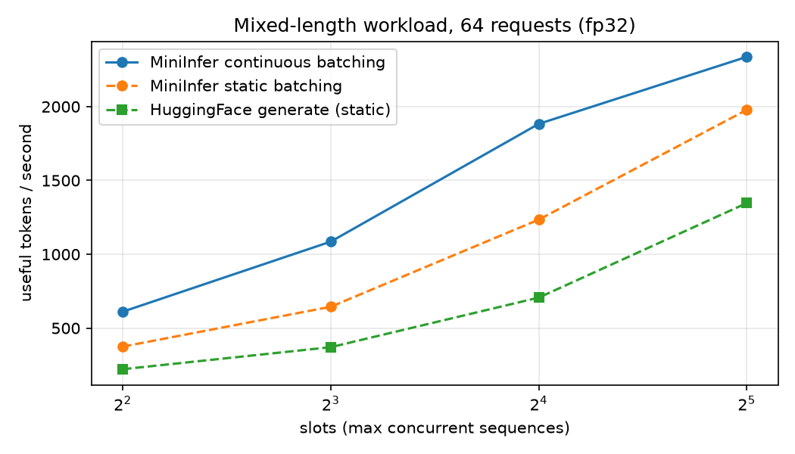
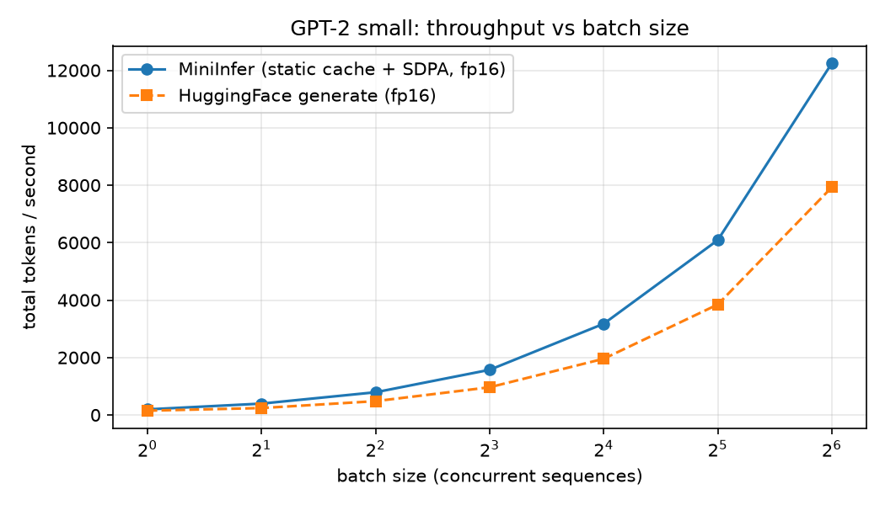

# MiniInfer

A small LLM inference engine, written from scratch in PyTorch. It runs GPT-2 (124M) with a hand-written forward pass and the serving optimizations that production systems like vLLM are built on: KV caching, batching, and continuous batching. Every step is verified against HuggingFace and benchmarked.

## Results

NVIDIA RTX 5060, PyTorch (CUDA 12.8), greedy decoding. Exact benchmark output, best of several runs.

| | Result |
|---|---|
| Batched decoding, batch 64 | **12,245 tokens/s** (fp16), 8,508 (fp32) |
| vs. single-request generation | **63x** (fp16), 45x (fp32) |
| vs. HuggingFace `generate()`, same batch | **1.54x** (fp16), 1.42x (fp32) |
| Continuous vs. static batching (mixed-length workload) | **up to 1.68x** |
| Continuous batching vs. HuggingFace static batching | **1.74x to 2.93x** |




Full tables, methodology and caveats: [docs/BENCHMARKS.md](docs/BENCHMARKS.md). How it works: [docs/DESIGN.md](docs/DESIGN.md).

## Correctness

Each optimization is checked against a reference before it is benchmarked:

- `verify.py`: logits match HuggingFace GPT-2 (max difference ~1e-4); greedy output matches token for token; the KV-cached loop equals the naive loop.
- `verify_batch.py`: left-padded batches give the same tokens as generating each prompt alone.
- `verify_engine.py`: continuous batching (8 requests through 3 slots, with slots freed and refilled mid-run) matches single-sequence output.

## Quick start (Windows PowerShell)

```powershell
python -m venv .venv
.venv\Scripts\Activate.ps1
pip install torch --index-url https://download.pytorch.org/whl/cu128
pip install transformers matplotlib

python verify.py
python verify_batch.py
python verify_engine.py
python benchmark_engine.py          # add --fp16 for half precision
```

RTX 50-series (Blackwell) GPUs need the CUDA 12.8 build of PyTorch. Python 3.12 or newer is required (`benchmark.py` uses f-string syntax from 3.12).

## Files

| File | Purpose |
|---|---|
| `model.py` | GPT-2 architecture, three KV caches, HuggingFace weight loader |
| `generate.py` | Naive, KV-cached and batched greedy decoding |
| `engine.py` | Continuous batching scheduler |
| `verify*.py` | Correctness checks |
| `benchmark*.py` | Benchmarks and charts |

## Roadmap

- [x] From-scratch forward pass, verified against HuggingFace
- [x] KV cache, static cache, fused attention, fp16
- [x] Batched generation with padding
- [x] Continuous batching with a per-slot KV cache
- [ ] Paged KV cache (block allocator)
- [ ] Speculative decoding
- [ ] CUDA graphs and a custom Triton attention kernel

## Limitations

Greedy decoding only, GPT-2 small only, one GPU. Each new request is prefilled alone, pausing decoding while it runs (production engines overlap or chunk this). Timings come from a desktop PC, so expect run-to-run noise of a few percent.
