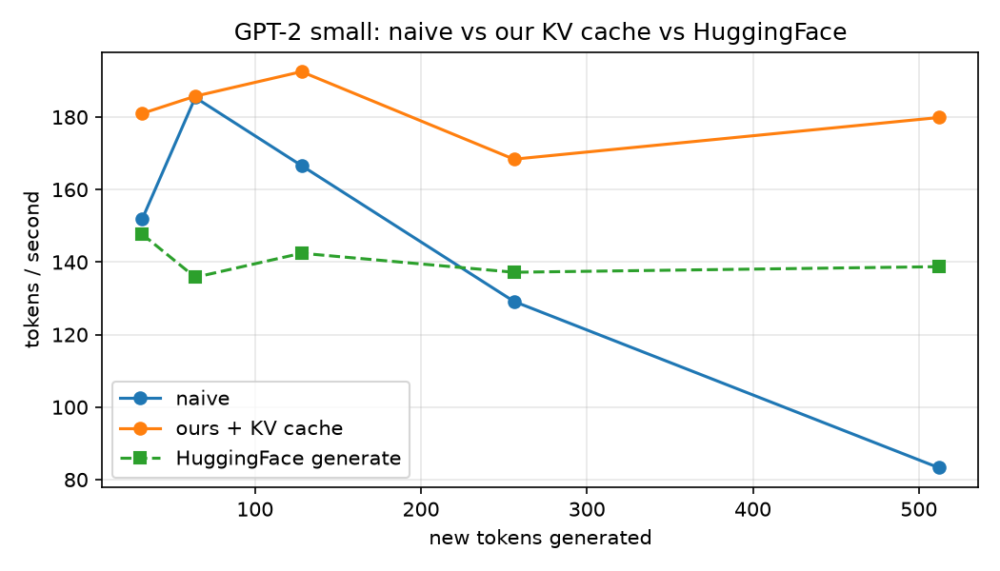
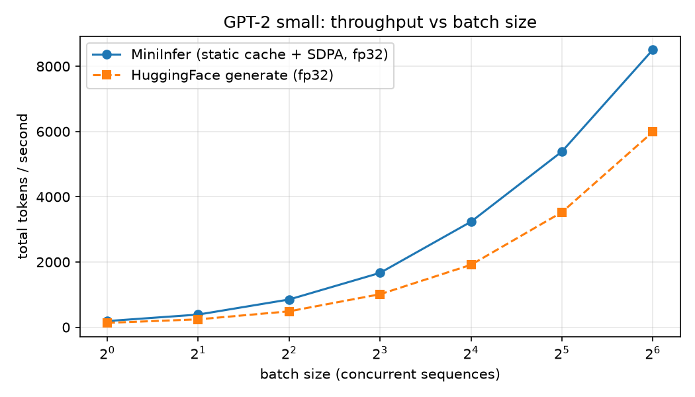
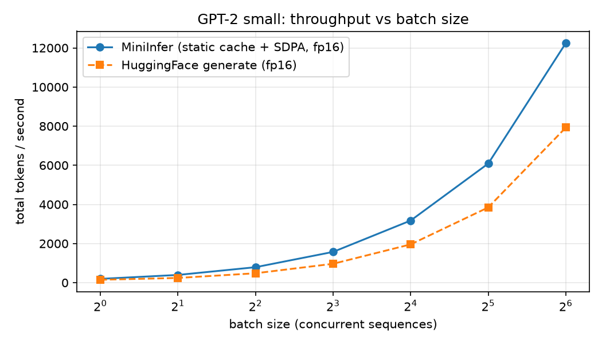
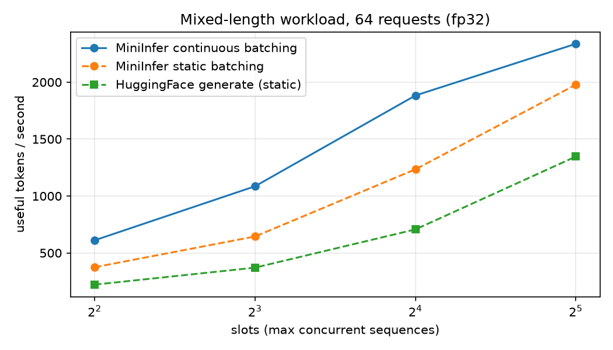

# Benchmarks

All numbers: NVIDIA RTX 5060, PyTorch (CUDA 12.8), GPT-2 small, greedy decoding, desktop PC (expect a few percent of run-to-run noise). Throughput is the best of several timed runs after a warmup. "HF" is HuggingFace `generate()` with `min_new_tokens` set so both engines produce exactly the same number of tokens.

Reproduce with `benchmark.py`, `benchmark_batch.py` and `benchmark_engine.py` (each accepts `--fp16` where noted in its header).

## 1. KV cache, single sequence (`benchmark.py`)

Tokens per second generating one sequence, fp32.

| new tokens | naive | MiniInfer + KV cache | HF generate |
|---|---|---|---|
| 32 | 197.7 | 195.6 | 148.9 |
| 64 | 190.4 | 197.5 | 150.1 |
| 128 | 173.2 | 189.9 | 150.3 |
| 256 | 131.4 | 189.5 | 148.0 |
| 512 | 84.8 | 193.4 | 143.7 |

Without a cache, throughput falls as the sequence grows because every step recomputes the whole sequence. With the cache it stays flat, about 2.3x faster at 512 tokens. The flat line (~190 tokens/s, ~5 ms per token) reflects launch overhead from many small GPU operations, not GPU compute, which is why batching helps so much.

## 2. Throughput vs batch size (`benchmark_batch.py`)

Total tokens per second across the batch, 128 new tokens per sequence.

**fp32**

| batch | MiniInfer | HF | MiniInfer vs HF | vs batch 1 |
|---|---|---|---|---|
| 1 | 189 | 134 | 1.41x | 1.0x |
| 2 | 388 | 242 | 1.60x | 2.1x |
| 4 | 851 | 488 | 1.74x | 4.5x |
| 8 | 1667 | 1011 | 1.65x | 8.8x |
| 16 | 3234 | 1913 | 1.69x | 17.1x |
| 32 | 5386 | 3526 | 1.53x | 28.5x |
| 64 | 8508 | 5988 | 1.42x | 45.0x |

**fp16**

| batch | MiniInfer | HF | MiniInfer vs HF | vs batch 1 |
|---|---|---|---|---|
| 1 | 193 | 149 | 1.30x | 1.0x |
| 2 | 395 | 240 | 1.64x | 2.0x |
| 4 | 790 | 480 | 1.65x | 4.1x |
| 8 | 1572 | 964 | 1.63x | 8.1x |
| 16 | 3175 | 1956 | 1.62x | 16.4x |
| 32 | 6087 | 3846 | 1.58x | 31.5x |
| 64 | 12245 | 7927 | 1.54x | 63.3x |

fp16 adds little at batch 1 (the engine is overhead-bound there) and helps most at large batches, where the GPU has real work to do.

## 3. Continuous vs static batching (`benchmark_engine.py`)

Workload: 64 requests with output lengths drawn from nine values between 16 and 256 tokens, all waiting at time 0, fp32. Throughput counts only useful tokens (what each request asked for). Static batching runs requests in fixed groups, and each group lasts as long as its longest request. Continuous batching refills a slot the moment its request finishes.

| slots | HF static | MiniInfer static | MiniInfer continuous | vs static | vs HF |
|---|---|---|---|---|---|
| 4 | 222 | 375 | 611 | 1.63x | 2.76x |
| 8 | 371 | 645 | 1086 | 1.68x | 2.93x |
| 16 | 707 | 1235 | 1883 | 1.53x | 2.66x |
| 32 | 1347 | 1978 | 2337 | 1.18x | 1.74x |

### Caveats

- The advantage shrinks at 32 slots. With 64 requests the run is short, so the final stretch with few requests left is a large share of the time. This explanation has not been tested; a larger workload would show the steady-state gain more fairly.
- Absolute speeds here are well below section 2. That benchmark is pure decoding on a fixed batch. This one also pays for prefilling each request alone, scheduling in Python, and one GPU-to-CPU sync per step. These costs have not been profiled yet.
- The baseline groups requests in arrival order. A smarter static scheduler that sorts requests by length would narrow the gap.
